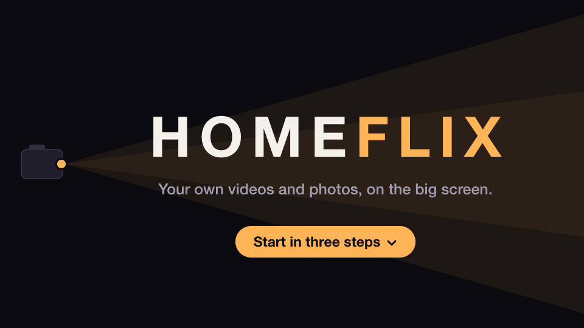

# HomeFlix

<p align="center">
  
</p>

Turn a folder of your own videos and photos into a private streaming library
for your living room. Your MacBook holds the files; your Smart TV opens a web
page and plays them. Nothing leaves your home Wi-Fi.

## What you need

- A Mac (macOS 12 or newer) and a Smart TV with a web browser
- Both connected to the **same Wi-Fi network**
- [Node.js](https://nodejs.org) 18 or newer (free; download the "LTS"
  installer and click through it)

Optional but recommended: **ffmpeg**, which adds video thumbnails, durations
and the "Convert" button for videos your TV cannot play. Install it with
[Homebrew](https://brew.sh): `brew install ffmpeg`.

## Install

**The easy way (no Terminal needed)**

1. Install [Node.js](https://nodejs.org): download the "LTS" installer for
   macOS and click through it.
2. On this page, click the green **Code** button, then **Download ZIP**.
3. Double-click the ZIP in your Downloads folder to unpack it, and move the
   `homeflix` folder somewhere you will find it again (Documents is fine).

**With git**

```bash
git clone https://github.com/utpal-barman/homeflix.git
cd homeflix
npm start
```

There is nothing else to install: HomeFlix has no dependencies, so there is no
`npm install` step.

## Start in three steps

1. **Open HomeFlix.** Double-click `HomeFlix.command` in this folder. A
   Terminal window opens and the control panel appears in your browser at
   `http://localhost:7788`.
   (The first time, macOS may say the file is from an unidentified developer:
   right-click it, choose **Open**, then **Open** again.)
2. **Add your media.** Drag videos and photos onto the Library area of the
   control panel, or point HomeFlix at a folder you already have (Folders →
   Add folder…).
3. **Turn on and watch.** Turn HomeFlix **ON** with the big button. On your TV, open the
   web browser and type the address shown on the card, for example
   `http://192.168.1.20:8080`. On a phone or tablet, scan the QR code instead.

If macOS asks "Do you want the application 'node' to accept incoming network
connections?", choose **Allow**. Without it the TV cannot reach the Mac.

To stop, turn it OFF. To quit HomeFlix completely, close the
Terminal window (or press `Ctrl+C` in it).

Prefer the command line? `npm start` does the same as the launcher.
`npm run serve` also turns the TV server on straight away.

## Using the TV app

| Remote button | What it does |
|---------------|--------------|
| Arrows | Move around |
| OK / Enter | Open, play, pause |
| Back | Go back one step |
| Left / Right while playing | Skip 10 seconds back / forward (hold to go faster) |
| Play, Pause, Fast-forward, Rewind | Work as expected where the TV passes them to the browser |
| OK in the photo viewer | Start or stop the slideshow |

Videos remember where you stopped and appear under **Continue Watching**.
Tip: bookmark the address in the TV browser so you only type it once.

## Server controls

Everything is in the control panel (`http://localhost:7788`, only reachable
from the Mac itself):

- **Turn on / Turn off** — whether the TV can reach your library right now.
- **Connect your TV** — the address, a QR code, and the TVs currently connected.
- **Library** — upload, preview, convert, show in Finder, move to Trash.
- **Folders** — where uploads are saved, and other folders to include.
- **Settings** — library name, port number, start automatically.

## Media folders

- **Library folder** (default `~/Movies/HomeFlix`): uploads are saved here. You
  can also copy files into it with Finder; they show up on their own. Change it
  under Folders → Change….
- **Extra folders**: folders you already have (say, `~/Pictures/Holidays`).
  HomeFlix shows and streams them in place and never modifies or deletes
  anything in them.

Subfolders become **collections** (rows on the TV): `Movies/HomeFlix/Italy 2024/…`
appears as "Italy 2024".

Subtitles: put a `.srt` or `.vtt` file with the same name next to the video
(`Trip.mp4` + `Trip.srt`).

## Supported formats

| Type | Files | On the TV |
|------|-------|-----------|
| Video | `.mp4`, `.m4v` (H.264 video, AAC audio) | Plays everywhere. The safe choice. |
| Video | `.mov`, `.webm` | Plays on many TVs, not all. |
| Video | `.mkv`, `.avi`, `.wmv`, `.flv`, `.mpg`, `.ts`, `.3gp` | Usually will not play in a TV browser. Use **Convert** (needs ffmpeg) to make an MP4 copy. |
| Photo | `.jpg`, `.png`, `.gif`, `.webp` | Yes |
| Photo | `.heic` (iPhone), `.tiff`, `.bmp` | Yes. Converted to JPEG for the TV automatically. |

Other file types are ignored.

## Smart TV browser limitations

TV browsers are slower and stricter than a laptop's. Good to know:

- **Codecs matter more than file extensions.** An `.mp4` filmed in HEVC/H.265
  (the iPhone "High Efficiency" setting) or with AC3/DTS surround audio may
  show a black picture or have no sound. Convert it, or set the iPhone camera
  to "Most Compatible".
- **4K and very high-bitrate files can stutter** over Wi-Fi. 1080p is the
  comfortable target. Seeking is instant on MP4 files; less so on others.
- **The TV may refuse to start playback on its own** — press OK/Play once.
- **The Mac must stay awake**, with HomeFlix running, on the same Wi-Fi. If the
  lid closes or the Mac sleeps, the TV shows "Can't reach your Mac" and
  reconnects by itself when it is back.
- **Some TVs have no browser** (or hide it). Look for "Internet", "Web Browser"
  or install one from the TV's app store. A games console, Fire TV (Silk) or
  Chromecast with Google TV browser works as well.
- Very old TVs (before roughly 2015) may not render the app correctly.

## Privacy

- The TV server only answers devices on your local network; anything else is
  refused. It is not reachable from the internet unless you deliberately
  forward the port on your router — don't.
- Anyone on your Wi-Fi who knows the address can view the library while the
  server is ON. Turn it OFF when you are done, and avoid public Wi-Fi.
- The TV app can only read (it saves nothing but where you stopped watching). Uploading, deleting and settings are possible
  only from the Mac itself.
- No accounts, no analytics, no internet connection needed.

## Troubleshooting

**The TV says the page can't be reached**
1. Is HomeFlix turned ON? Is the Terminal window still open?
2. Are the TV and Mac on the same Wi-Fi name? "Guest" networks and some mesh
   or hotel networks stop devices from talking to each other.
3. Did you allow incoming connections for "node"? Check System Settings →
   Network → Firewall → Options.
4. Turn off any VPN on the Mac.
5. Try the alternative addresses listed on the Connect card.

**The address changed** — routers sometimes hand the Mac a new address. The
control panel always shows the current one.

**A video shows as "Needs converting"** — press Convert in the Library (install
ffmpeg first). The original file is kept.

**"Port already in use"** — another app is using that number. HomeFlix picks
the next free one by itself; the card shows the real address.

## For developers

```
bin/homeflix.js     entry point (--no-open, --serve, --control-port <n>)
server/             Node server, built-ins only, no npm dependencies
web/admin/          Mac control panel
web/tv/             TV app (ES5, no dependencies)
web/shared/         assets used by both
test/               node:test suite — run with `npm test`
docs/ARCHITECTURE.md   API contract and design language
```

Settings live in `~/Library/Application Support/HomeFlix/`, the thumbnail
cache in `~/Library/Caches/HomeFlix/` (safe to delete). Set `HOMEFLIX_HOME` to
keep everything in one directory instead.

## License

[MIT](LICENSE). Your media never leaves your network, and neither does anything else.

Commits follow [Conventional Commits](https://www.conventionalcommits.org);
see `CLAUDE.md` for the project rules.
